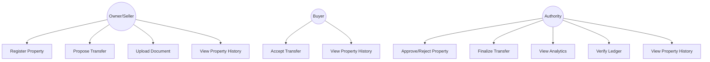
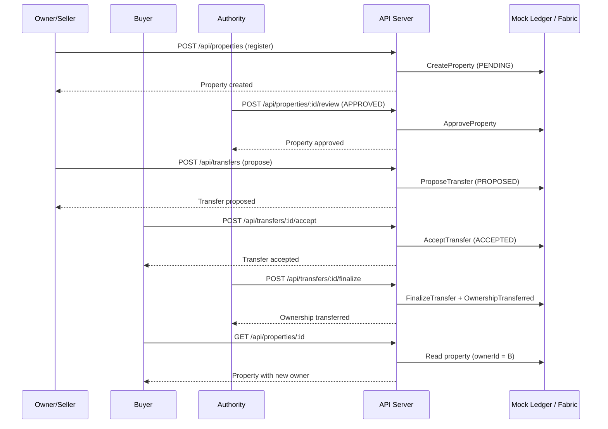
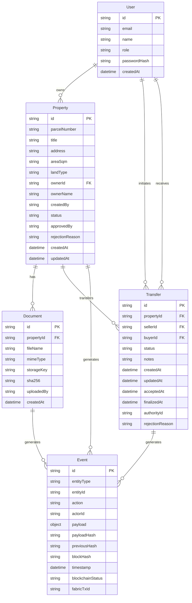

# Blockchain-Based Land Record and Property Transaction Management System

> **Academic prototype - not a government land registry.** This demonstration application uses sample identities and records. It does not connect to a government database, issue legally binding titles, or replace official registration procedures.

## What is included

- Role-based access for **owner**, **buyer**, **seller**, and **authority/admin** users.
- Property registration, authority approval/rejection, ownership verification, and transfer requests.
- Document upload metadata with SHA-256 hashes, integrity verification, and off-chain file storage.
- A tamper-evident local mock ledger: each history entry records a payload hash, previous block hash, and block hash.
- Duplicate/conflicting ownership detection and an authority analytics dashboard.
- PostgreSQL repository/schema for containerized deployment.
- Go chaincode and Fabric network configuration templates for moving the prototype to a permissioned Fabric network.
- A polished React/Vite interface and REST API.

## Quick start - mock ledger (recommended for demo)

Prerequisites: Node.js 20+ and npm.

```bash
copy .env.example .env
npm install
npm install --prefix server
npm install --prefix client
npm run seed
npm run dev
```

Open `http://localhost:5173`. The API runs at `http://localhost:5000`.

`DATABASE_MODE=mock` is the default. It stores non-sensitive demo data at `server/data/ledger.json` and uploaded files in `server/uploads/`. Do not use the mock ledger for real records.

### Demo accounts

| Role | Email | Password |
| --- | --- | --- |
| Authority | authority@landledger.demo | Authority@123 |
| Owner | ananya.owner@landledger.demo | Owner@123 |
| Buyer | rohan.buyer@landledger.demo | Buyer@123 |
| Seller | meera.seller@landledger.demo | Seller@123 |

## PostgreSQL and Docker

For the full PostgreSQL-backed container setup:

```bash
docker compose up --build
```

Open `http://localhost:8080`. The API automatically uses the supplied `POSTGRES_URL` when `DATABASE_MODE=postgres`.

To use Postgres outside Docker, create a database with `server/sql/schema.sql`, set `DATABASE_MODE=postgres` and `POSTGRES_URL` in `.env`, then run the seed script.

## Workflow

1. An owner or seller registers a property with core metadata and an optional title document.
2. The system calculates a SHA-256 document digest and stores the file off-chain. The digest and storage key are recorded in the ledger history.
3. An authority reviews the submitted property. Approved properties can be transferred.
4. A seller/owner proposes a transfer; the buyer accepts it; an authority finalizes it after ownership validation.
5. Every status or ownership event is appended to the mock ledger. The integrity endpoint recomputes the hash chain.
6. The analytics screen flags repeated parcels, multiple active owners, duplicate document hashes, and pending transfers.

## REST API overview

| Method | Route | Purpose |
| --- | --- | --- |
| POST | `/api/auth/login` | Receive a role-aware JWT |
| GET | `/api/properties` | Browse properties filtered by access role |
| POST | `/api/properties` | Register a property and optional document |
| GET | `/api/properties/:id/history` | View tamper-evident ownership history |
| POST | `/api/transfers` | Propose a property transfer |
| POST | `/api/transfers/:id/accept` | Buyer accepts a proposal |
| POST | `/api/transfers/:id/finalize` | Authority validates and finalizes transfer |
| GET | `/api/analytics/overview` | Authority analytics and conflict flags |
| GET | `/api/ledger/verify` | Check mock-ledger hash chain integrity |

## Hyperledger Fabric Integration

The application supports two ledger modes, controlled by `FABRIC_MODE` in `.env`:

- **`mock`** (default): Uses the existing MockStore ledger. No Fabric infrastructure required. Recommended for demos and development.
- **`fabric`**: Submits real transactions to a Hyperledger Fabric network via the `@hyperledger/fabric-gateway` SDK.

### Fabric network configuration

The expected Fabric network topology:

| Setting | Value |
| --- | --- |
| Channel | `landledgerchannel` |
| Chaincode | `landrecords` |
| Chaincode version | 1.1 (sequence 4) |
| Organizations | Org1MSP, Org2MSP |
| MSP ID | Org1MSP |
| Peer endpoint | `localhost:7051` (configure via `FABRIC_PEER_ENDPOINT`) |

### Identity mapping

Four enrolled Fabric identities correspond to application users. The mapping is in `server/src/config.js`:

| App userId | Fabric identity label | Role |
| --- | --- | --- |
| 1 | LedgerAuthority | authority |
| 2 | LedgerOwner | owner |
| 3 | LedgerBuyer | buyer |
| 4 | LedgerSeller | seller |

Each identity must have `role` and `appUserId` attributes in its X.509 certificate. Identity files (certificate + private key) are expected at:

```
fabric/wallet/<IdentityLabel>/certificate.pem
fabric/wallet/<IdentityLabel>/privateKey.pem
```

Never commit private keys or wallet files to Git. They are excluded via `.gitignore`.

### TLS configuration

The gateway connects to the Fabric peer over gRPC with TLS. Configure via environment variables:

| Variable | Description | Default |
| --- | --- | --- |
| `FABRIC_MODE` | `mock` or `fabric` | `mock` |
| `FABRIC_CHANNEL` | Fabric channel name | `landledgerchannel` |
| `FABRIC_CHAINCODE` | Chaincode name | `landrecords` |
| `FABRIC_MSP_ID` | MSP organization ID | `Org1MSP` |
| `FABRIC_PEER_ENDPOINT` | Gateway peer host:port | `localhost:7051` |
| `FABRIC_TLS_CA_CERT_PATH` | Path to peer TLS CA certificate | (empty) |
| `FABRIC_WALLET_PATH` | Path to identity wallet directory | `fabric/wallet` |

The TLS hostname override is derived from the peer endpoint hostname. For Dockerized deployments, set `FABRIC_PEER_ENDPOINT` to the peer service name and `FABRIC_TLS_CA_CERT_PATH` to the mounted CA certificate.

### Chaincode

The Go chaincode lives at `fabric/chaincode/landrecords/landrecords.go`. It enforces certificate-based authorization using the `role` and `appUserId` client identity attributes:

- **CreateProperty**: caller's `appUserId` must match `ownerID`; role must be owner, seller, or authority.
- **ApproveProperty**: authority/admin only.
- **ProposeTransfer**: caller's `appUserId` must match `sellerID`; seller must own an APPROVED property; no duplicate open transfers.
- **AcceptTransfer**: caller's `appUserId` must match `buyerID`; transfer must be PROPOSED.
- **FinalizeTransfer**: authority/admin only; transfer must be ACCEPTED; updates ownership atomically.
- **RejectTransfer**: authority or designated buyer; transfer must be PROPOSED or ACCEPTED.
- **RecordDocumentHash**: records SHA-256 document hash on-chain (storage keys stay off-chain).
- **GetPropertyHistory**: returns Fabric transaction history for a property.

Timestamps are derived from the Fabric transaction context (`GetTxTimestamp`), not system time. Storage keys are never written on-chain.

### Compiling and deploying chaincode

From the repository root (requires Go 1.21+ in WSL2 or Linux):

```bash
cd fabric/chaincode/landrecords
gofmt -w landrecords.go
go build ./...
go vet ./...
```

Package and deploy to the existing `landledgerchannel` as version 1.1, sequence 4. Do not recreate the channel. Both Org1MSP and Org2MSP must approve and install the new definition.

### Fabric mode setup

1. Start your Hyperledger Fabric network (Fabric 2.5+) with channel `landledgerchannel`.
2. Deploy chaincode `landrecords` version 1.1 (sequence 2) on `landledgerchannel`.
3. Enroll identities for LedgerAuthority, LedgerOwner, LedgerBuyer, LedgerSeller with `role` and `appUserId` attributes.
4. Place identity certificates and private keys under `fabric/wallet/<IdentityLabel>/`.
5. Obtain the peer TLS CA certificate and set `FABRIC_TLS_CA_CERT_PATH`.
6. Set `FABRIC_MODE=fabric` in `.env`.
7. Start the API: `npm run dev` (from `server/`).

### Mock mode (default)

Set `FABRIC_MODE=mock` (or omit it). The existing MockStore ledger behavior remains unchanged. No Fabric identities or network are required.

```bash
copy .env.example .env
npm install
npm install --prefix server
npm install --prefix client
npm run seed
npm run dev
```

### Testing

Run the backend test suite:

```bash
npm test
```

Run from `server/`. Tests run in mock mode and verify login, role authorization, document hashing, authority approval, transfer lifecycle, and mock-ledger integrity.

Build the frontend:

```bash
npm run build
```

Run from `client/`.

### Fabric mode testing scenarios

When `FABRIC_MODE=fabric`, verify:

1. Authority login and property approval recorded on-chain.
2. Owner login and property registration recorded on-chain.
3. Transfer proposal, buyer acceptance, and authority finalization recorded on-chain.
4. Property ownership changes reflected on-chain after finalization.
5. `GetPropertyHistory` returns Fabric transaction history.
6. Unauthorized transactions rejected (e.g., buyer cannot approve property, wrong buyer cannot accept transfer).
7. Failed Fabric transactions return errors without silently updating the database.
8. Mock mode continues to work when `FABRIC_MODE=mock`.

## Test Results

The following tests were executed and verified:

| Test Category | Tests | Pass | Fail | Skip | Mode |
|---|---|---|---|---|---|
| Backend unit tests | 2 | 2 | 0 | 0 | mock |
| E2E workflow (login → register → approve → propose → accept → finalize → verify) | 20 | 20 | 0 | 1 | fabric |
| Security & authorization | 9 | 7 | 0 | 2 | mock |
| Database & Fabric consistency | 9 | 9 | 0 | 0 | mock |
| Frontend production build | 1 | 1 | 0 | 0 | N/A |

All Fabric-mode E2E tests were run against the live Hyperledger Fabric network (`landrecords` v1.1, sequence 4, channel `landledgerchannel`).

## System Diagrams

### Architecture Diagram

```mermaid
graph TB
    subgraph Client Layer
        UI[React/Vite Frontend]
    end

    subgraph API Layer (Node.js/Express)
        API[REST API Server]
        Auth[JWT Authentication]
        RBAC[Role-Based Access Control]
    end

    subgraph Data Layer
        MockStore[(Mock Ledger - ledger.json)]
        PG[(PostgreSQL - optional)]
        Uploads[/Off-Chain File Storage]
    end

    subgraph Fabric Layer
        FW[Fabric Wallet - Identities]
        GW[Fabric Gateway SDK]
        CC[Chaincode: landrecords v1.1]
        P2[Peer: peer0.org1.example.com:7051]
        P3[Peer: peer0.org2.example.com:9051]
        O[Orderer: orderer.example.com:7050]
        CH[(Channel: landledgerchannel)]
    end

    UI --> API
    API --> Auth
    API --> RBAC
    API --> MockStore
    API -.->|FABRIC_MODE=fabric| GW
    GW --> FW
    GW --> P2
    P2 --> CH
    CH --> CC
    API --> Uploads
```

### Use-Case Diagram



### Ownership Transfer Sequence Diagram



### Database ER Diagram



## Academic Prototype Disclaimer

> **This is an academic prototype, not a government land registry.** The application uses sample identities and records. It does not connect to any government database, issue legally binding titles, or replace official land registration procedures. Blockchain records here demonstrate a permissioned ledger architecture for educational purposes only. For any production or legal use, consult qualified legal and technical professionals and comply with applicable land registration laws.

## REST API overview

| Method | Route | Purpose |
| --- | --- | --- |
| POST | `/api/auth/login` | Receive a role-aware JWT |
| GET | `/api/properties` | Browse properties filtered by access role |
| POST | `/api/properties` | Register a property and optional document |
| GET | `/api/properties/:id/history` | View ownership history (mock ledger or Fabric) |
| POST | `/api/transfers` | Propose a property transfer |
| POST | `/api/transfers/:id/accept` | Buyer accepts a proposal |
| POST | `/api/transfers/:id/finalize` | Authority validates and finalizes transfer |
| POST | `/api/transfers/:id/reject` | Reject a proposed or accepted transfer |
| GET | `/api/analytics/overview` | Authority analytics and conflict flags |
| GET | `/api/ledger/verify` | Check mock-ledger hash chain integrity |

## Database and blockchain consistency

The database and blockchain are separate systems and do not share an atomic transaction. The application:

1. Updates the database first (property, transfer, document records).
2. Submits the corresponding Fabric transaction.
3. If the Fabric transaction succeeds, records the transaction ID and `confirmed` status in the local event log.
4. If the Fabric transaction fails, the error is propagated to the client and the event is marked `failed`.

Retries are idempotent: chaincode operations check for existing state before creating new records, preventing duplicate property creation or transfers after a retry.

## Security limitations

> **Academic prototype - not a government land registry.** This demonstration application uses sample identities and records. It does not connect to a government database, issue legally binding titles, or replace official registration procedures.

- Certificate-based authorization relies on Fabric client identity attributes (`role`, `appUserId`) issued by the CA. The application does not enroll identities or manage the Fabric CA.
- Private keys and wallet files must be kept outside the repository.
- Only SHA-256 document hashes are recorded on-chain; document contents and storage keys remain off-chain.
- Production deployment requires HTTPS, secret rotation, malware scanning, object-storage encryption, data retention policies, input throttling, and an independent security review.

## Security notes

- Passwords are hashed with bcrypt; authentication is signed JWT-based.
- Authorization is enforced on API routes, not only in the UI.
- Uploaded files are kept off-chain. Only SHA-256 fingerprints and storage references are written to the ledger history.
- Production deployment requires HTTPS, secret rotation, malware scanning, object-storage encryption, data retention policies, input throttling, and an independent security review.

## Vercel deployment

The frontend is built from `client/`, while API routes are served from `api/`. The login endpoint has an explicit Vercel function at `api/auth/login.mjs` so `POST /api/auth/login` is routed directly to the Express application.


### Login security

The frontend no longer contains demo passwords or pre-fills credentials. Demo role buttons call `/api/auth/demo-login`; this endpoint is disabled unless `DEMO_MODE=true`. For any real/public production system, keep `DEMO_MODE=false` and use real account authentication.
