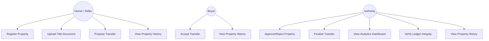
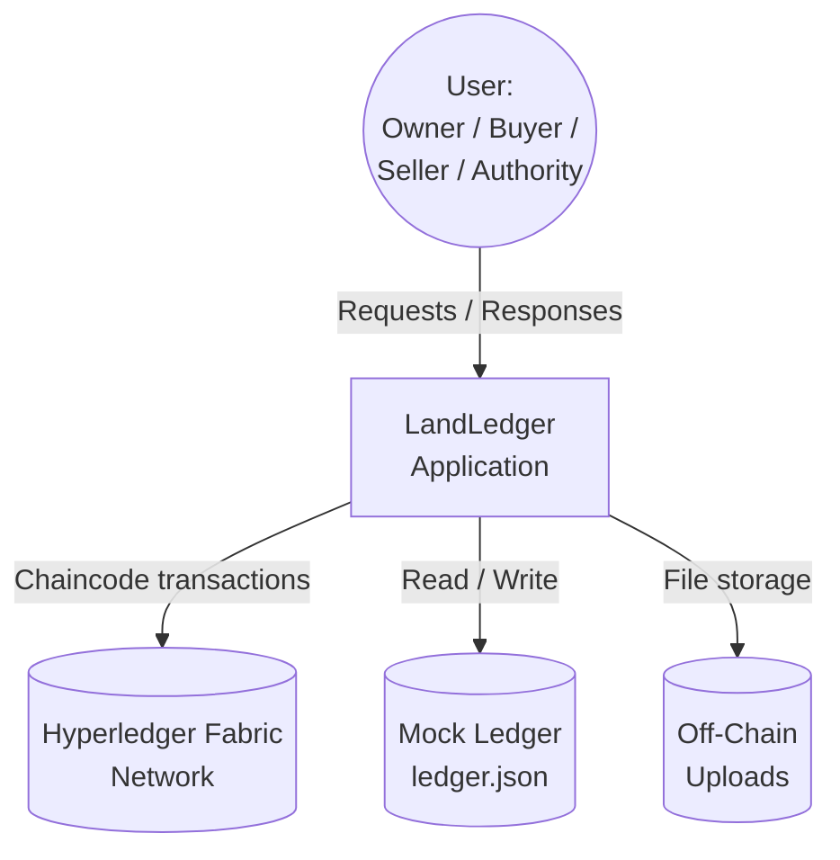
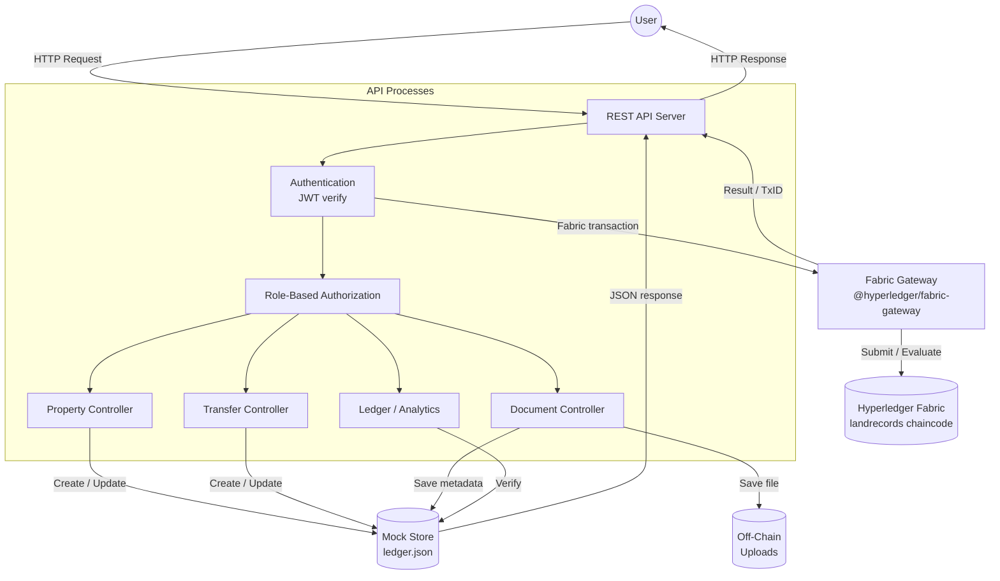

# System Architecture and Diagrams

## System Architecture Diagram

```mermaid
graph TB
    subgraph Client_Layer["Client Layer"]
        UI[React/Vite Frontend<br/>http://localhost:5173]
    end

    subgraph API_Layer["API Layer (Node.js/Express)<br/>http://localhost:5000"]
        API[REST API Server<br/>server/src/server.js]
        Auth[JWT Authentication<br/>server/src/services/authService.js]
        RBAC[Role-Based Access Control<br/>allow() middleware]
        LedgerSvc[Ledger Service<br/>server/src/services/ledgerService.js]
        FabricGW[Fabric Gateway SDK<br/>server/src/services/fabricGateway.js]
    end

    subgraph Data_Layer["Data Layer"]
        MockStore[(Mock Ledger<br/>server/data/ledger.json)]
        PG[(PostgreSQL<br/>optional)]
        Uploads[/Off-Chain File Storage<br/>server/uploads/]
    end

    subgraph Fabric_Layer["Hyperledger Fabric Layer<br/>(FABRIC_MODE=fabric)"]
        FW[Fabric Wallet<br/>fabric/wallet/<br/>LedgerAuthority, LedgerOwner,<br/>LedgerBuyer, LedgerSeller]
        GW[Fabric Gateway<br/>@hyperledger/fabric-gateway]
        CC[Chaincode: landrecords v1.1<br/>fabric/chaincode/landrecords/]
        P1[Peer: peer0.org1.example.com:7051]
        P2[Peer: peer0.org2.example.com:9051]
        O[Orderer: orderer.example.com:7050]
        CH[(Channel: landledgerchannel)]
    end

    UI --> API
    API --> Auth
    API --> RBAC
    API --> LedgerSvc
    API --> MockStore
    API -.->|FABRIC_MODE=fabric| FabricGW
    FabricGW --> FW
    FabricGW --> P1
    P1 --> CH
    CH --> CC
    API --> Uploads
    LedgerSvc -.->|evaluate()| FabricGW
```

## Use-Case Diagram



**Actors and their use cases:**

| Actor | Use Cases |
|---|---|
| Owner | Register Property, Upload Document, Propose Transfer, View Property History |
| Seller | Register Property, Upload Document, Propose Transfer, View Property History |
| Buyer | Accept Transfer, View Property History |
| Authority | Approve/Reject Property, Finalize Transfer, View Analytics, Verify Ledger, View Property History |

## DFD Level 0 (Context Diagram)



**Level 0 Description:**
- **External Entity:** User (any of the four roles) interacts with the LandLedger application through the web UI.
- **System:** LandLedger Application — the combined frontend + backend that processes all requests.
- **Data Stores:** Mock Ledger (JSON event store), Off-Chain File Storage (uploaded documents), Hyperledger Fabric Network (Fabric mode only).
- **Data Flows:** User submits requests; system reads/writes to data stores; system submits chaincode transactions to Fabric when in Fabric mode.

## DFD Level 1 (Detailed)



### Level 1 Processes

| Process ID | Process Name | Description |
|---|---|---|
| P1 | Authentication | Validates JWT token, extracts user role and ID |
| P2 | Authorization | Checks user role against route permissions (allow() middleware) |
| P3 | Property Controller | Handles property registration, review, and detail views |
| P4 | Transfer Controller | Handles transfer proposal, acceptance, finalization, rejection |
| P5 | Document Controller | Handles document upload, metadata storage, and download |
| P6 | Ledger Service | Routes events to MockStore (mock mode) or Fabric Gateway (Fabric mode) |
| P7 | Analytics Service | Computes conflict flags, summary statistics, ledger integrity |

### Data Stores

| Store ID | Description |
|---|---|
| DS1 | Mock Store — `server/data/ledger.json` — users, properties, documents, transfers, events |
| DS2 | Off-Chain Uploads — `server/uploads/` — uploaded document files |
| DS3 | Fabric Wallet — `fabric/wallet/` — identity certificates and private keys |
| DS4 | Fabric World State — chaincode state on peers |

### Data Flows

| Flow ID | From | To | Data |
|---|---|---|---|
| F1 | User | API | HTTP requests (login, property, transfer, document) |
| F2 | API | MockStore | User credentials, property records, transfer records, events |
| F3 | API | Uploads | Document files (off-chain storage) |
| F4 | API | Fabric Gateway | Chaincode transaction proposals (Fabric mode) |
| F5 | Fabric Gateway | API | Transaction results, transaction IDs |
| F6 | MockStore | API | JSON responses (properties, transfers, analytics, integrity) |
