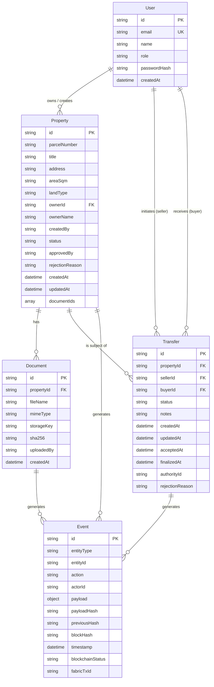

# Database ER Diagram

## Entity-Relationship Diagram

## Entity Descriptions

### User
Represents a registered user in the system. Four roles: `authority`, `owner`, `buyer`, `seller`. Passwords are hashed with bcrypt. Used for JWT authentication and authorization.

### Property
Represents a land record. Contains parcel metadata, ownership information, and review status. Status transitions: `PENDING` → `APPROVED`/`REJECTED`. Owner changes only through finalized transfers.

### Document
Represents an uploaded title document. The actual file is stored off-chain in `server/uploads/`. Only metadata (filename, MIME type, storage key, SHA-256 hash) and the hash are recorded in the ledger.

### Transfer
Represents a proposed or completed ownership transfer. Status transitions: `PROPOSED` → `ACCEPTED` → `FINALIZED` or `REJECTED`. Links a property, seller, and buyer.

### Event
Represents an immutable entry in the tamper-evident ledger. Each event contains a payload hash, previous block hash, and its own block hash, forming a verifiable chain. Records both mock-mode and Fabric-mode transactions.

## Relationships

| Relationship | Cardinality | Description |
|---|---|---|
| User → Property | 1:N | A user owns or creates multiple properties |
| User → Transfer | 1:N | A user initiates transfers (as seller) or receives them (as buyer) |
| Property → Document | 1:N | A property can have multiple uploaded documents |
| Property → Transfer | 1:N | A property can be subject to multiple transfers over time |
| Property → Event | 1:N | Each property generates multiple ledger events |
| Transfer → Event | 1:N | Each transfer generates multiple ledger events |
| Document → Event | 1:N | Each document upload generates ledger events |

## Fabric World State Keys (Fabric Mode)

In Fabric mode, chaincode stores state using these key prefixes:

| Key Prefix | Description |
|---|---|
| `property:<id>` | Property record (JSON serialized `Property` struct) |
| `transfer:<id>` | Transfer record (JSON serialized `Transfer` struct) |
| `documenthash:<id>` | Document hash record (JSON serialized `DocumentHashRecord` struct) |
