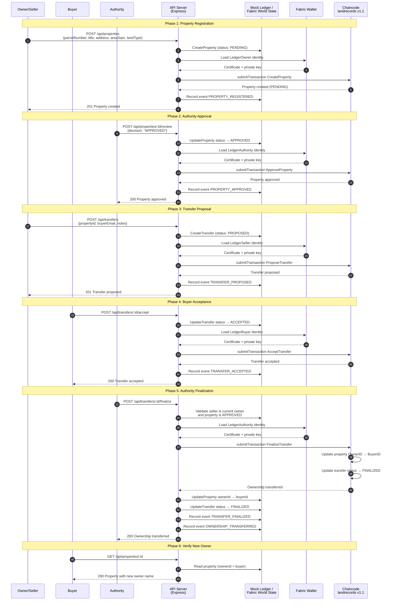

# Sequence Diagram: Property Ownership Transfer

## Complete Transfer Workflow

## Step-by-Step Description

| Step | Actor | Action | System Response |
|---|---|---|---|
| 1 | Owner/Seller | Registers property with metadata + optional document | Property created with status `PENDING`, recorded on ledger |
| 2 | Authority | Reviews and approves the property | Property status → `APPROVED`, transferable |
| 3 | Owner/Seller | Proposes transfer to a buyer (email lookup) | Transfer created with status `PROPOSED` |
| 4 | Buyer | Accepts the proposed transfer | Transfer status → `ACCEPTED` |
| 5 | Authority | Validates seller is current owner and finalizes | Property ownerId changes to buyer; transfer status → `FINALIZED` |
| 6 | Buyer | Views property to confirm new ownership | Property displays buyer as owner |

## Authorization Checks at Each Step

| Step | API Authorization | Chaincode Authorization |
|---|---|---|
| Register Property | `owner`, `seller`, `authority` roles | Role: owner/seller/authority; appUserId matches ownerID |
| Approve Property | `authority`, `admin` roles | Role: authority/admin |
| Propose Transfer | `owner`, `seller` roles | Role: owner/seller; appUserId matches sellerID; property APPROVED |
| Accept Transfer | No role restriction (buyerId check) | Role: buyer/owner; appUserId matches buyerID; transfer PROPOSED |
| Finalize Transfer | `authority`, `admin` roles | Role: authority/admin; transfer ACCEPTED; seller is current owner |

## Error Conditions Handled

| Condition | HTTP Status | Chaincode Error |
|---|---|---|
| Property not found | 404 | "property X does not exist" |
| Property not approved | 400 | "ownership validation failed" |
| Not the owner | 403 | "caller appUserId does not match sellerID" |
| Duplicate open transfer | 409 | "an open transfer already exists for property X" |
| Transfer not found | 404 | "transfer X does not exist" |
| Transfer not proposed | 409 | "only proposed transfers can be accepted" |
| Wrong buyer | 403 | "caller appUserId does not match buyerID" |
| Already finalized | 409 | "only accepted transfers can be finalized" |
